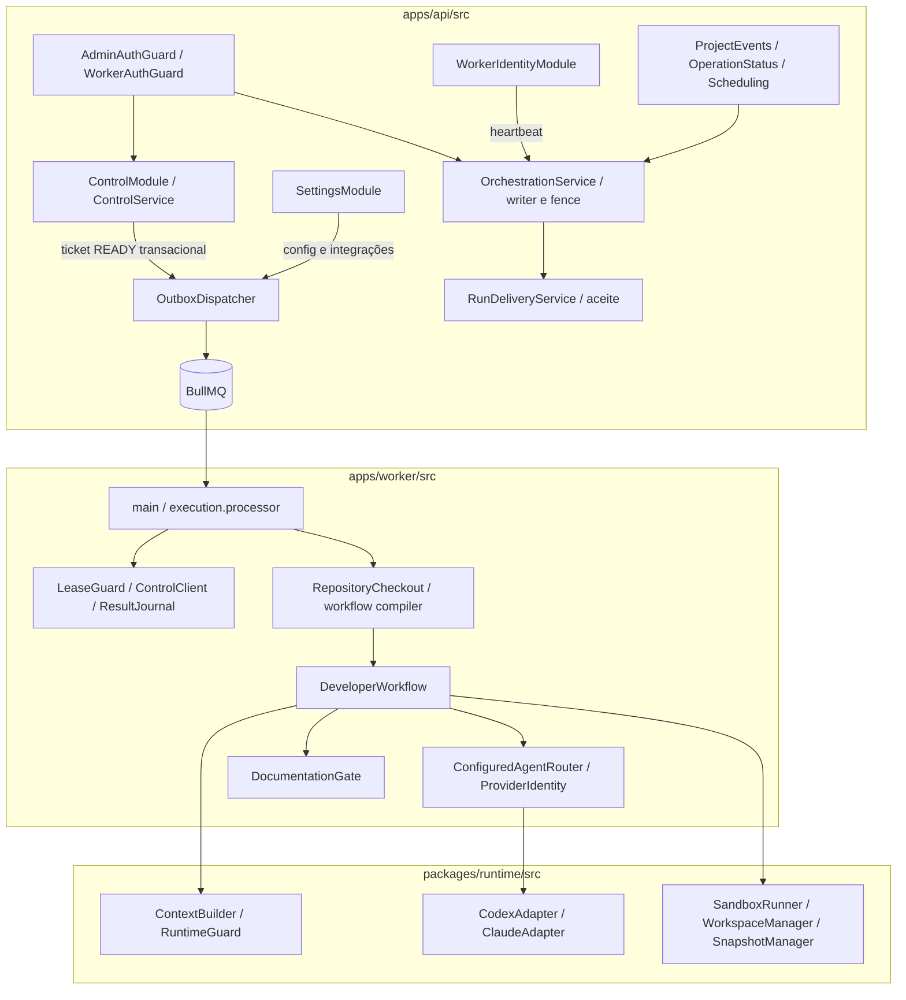

> Leitura: [← Anterior](03-containers.md) · [Índice didático](../02-INDEX.md) · [Próximo →](05-fluxos.md)

# C4 nível 3 — componentes atuais

Base a2cc5e0. Monólito modular na API; responsabilidades do worker/runtime em processo separado. Caminhos reais, sem src/modules inventado.

Context Builder e execução do gate são no worker/runtime, não shell na API. API valida evidências/hashes para aceite. PostgreSQL fecha exclusão global; BullMQ lock não a substitui. Antigravity possui integração de login/status, sem adapter de execução. [Componentes alvo](12-componentes-alvo.md) acrescentam tenancy/broker/capabilities propostos.

## Componente de conta — FAC-038

AccountModule na API contém AccountAuthController/AccountController, AccountGuard e AccountService. Guarda identidade humana/configuração pessoal, membership/convites/sessões e auditoria no PostgreSQL; Redis é usado para limitar autenticação. React AccountPanel consome somente DTOs Zod sem credencial administrativa. AccountWorkService reutiliza serviços de domínio dentro da mesma transação do check de autorização; AccountDataService, AccountIdentityService, AccountEmailService e AccountBillingService cuidam dos recursos privados. AccountWorkerController entrega credencial GitHub apenas ao supervisor com lease/fence válidos; worker consulta configuração do projeto e revalida autoridade. Broker/isolamento hostil permanecem propostos. [Decisão](../06-decisoes/ADR-007-conta-usuario-e-sessoes.md).
