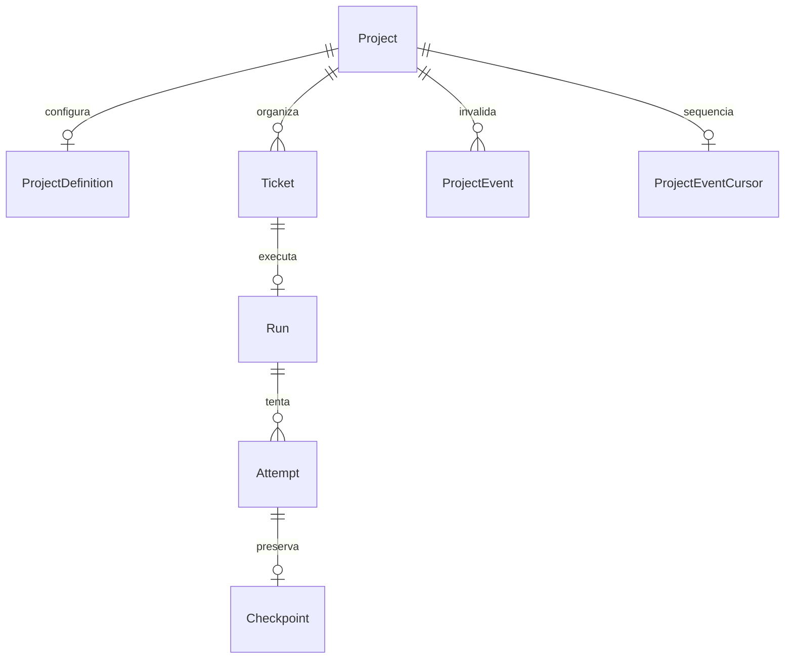
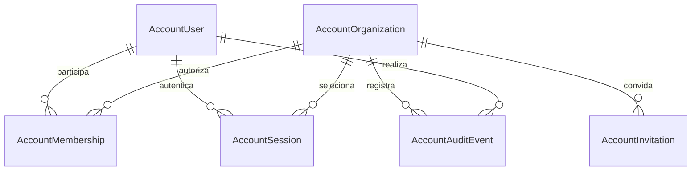

> Leitura: [← Anterior](05-fluxos.md) · [Índice didático](../02-INDEX.md) · [Próximo →](07-fronteiras-e-invariantes.md)

# Dados — estrutura observada

Base a2cc5e0, conferido em schema Prisma. Migrations podem impor invariantes adicionais. [Contrato de dados](../05-contratos/schemas/00-entidades.md).

Run único por ticket; resultados/artifacts/approval/configuração são JSON. OutboxEvent persiste intenção no banco, Redis transporta. Nenhuma tenancy/RLS/Step/Ledger físico nesta revisão. [Dados alvo propostos](14-dados-alvo.md).

## Dados da conta — FAC-038

Migration aditiva cria AccountUser, AccountOrganization, AccountMembership, AccountSession, AccountInvitation e AccountAuditEvent; dados de projeto/configuração anteriores permanecem independentes. [Modelo/contratos](../05-contratos/schemas/00-entidades.md#conta-do-usuário--fac-038). Nenhuma atribuição automática de registros globais ou migração para cliente é inferida.

Status: IMPLEMENTADO no diff FAC-038, aplicado apenas no banco temporário de teste; aceite/implantação pendentes.

## Ownership e recursos complementares — FAC-039–041

Migration 20261009140000_account_features adiciona organizationId nullable em Project, dados de segurança em AccountUser e plano/faturamento/retenção em AccountOrganization. AccountProjectGrant/IntegrationGrant têm FKs compostas por organização; owner único usa índice parcial. AccountJobAuthority conserva identidade do solicitante. Integrações privadas, configuração de agentes por projeto, reserva de storage por attempt, tokens de segurança, outbox SMTP criptografado, notificações, intenções/eventos/faturas de cobrança e transferência persistem em tabelas dedicadas. Trigger de ticket deriva notificações de estado real e prefere grants/preferências atuais. [Contrato físico](../05-contratos/schemas/00-entidades.md#recursos-da-conta--fac-039041). Nenhum backfill de propriedade é automático; nenhuma tabela operacional ativa foi migrada nesta entrega.
