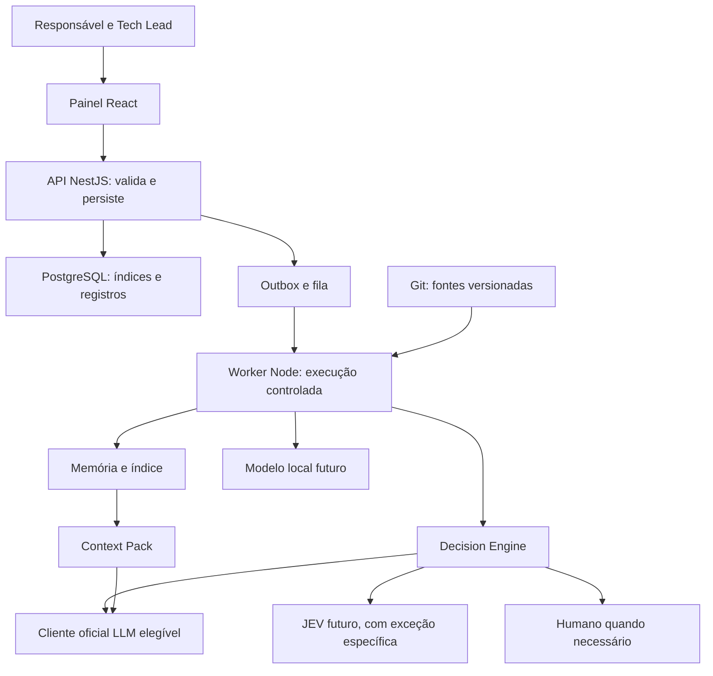

> Leitura: [← Anterior](00-README.md) · [Índice didático](../../02-INDEX.md) · [Próximo →](02-memoria-persistente.md)

# Visão integrada: memória, contexto e decisão

## O problema em um exemplo

Imagine que uma tarefa modifica recuperação de execução. Uma IA precisa conhecer regras de parada, checkpoint e escrita exclusiva. A sessão termina e outra IA assume. O conhecimento e o trabalho não podem desaparecer junto com a primeira sessão. Essa situação é um exemplo didático, não uma execução real registrada.

A arquitetura separa quatro coisas: fontes que explicam o software; mecanismos que encontram essas fontes; pacote entregue a uma tarefa; mecanismos que escolhem entre opções permitidas. Isso permite substituir um modelo sem reconstruir o conhecimento do projeto.

## Vocabulário inicial

| Termo | Significado e função |
|---|---|
| Arquitetura | Organização de responsabilidades, dados, contratos e limites |
| Fonte | Arquivo, teste, contrato ou registro identificável que sustenta uma afirmação |
| Proveniência | De onde veio a informação e em qual versão |
| Contrato | Entradas, saídas, regras e erros de uma interação |
| Schema | Descrição verificável do formato dos dados |
| API | Interface pela qual componentes trocam pedidos e respostas |
| Worker | Processo que executa trabalhos fora da API administrativa |
| Política | Regras autorizadas aplicadas fora do modelo |
| Gate | Condição obrigatória para avançar uma operação |
| Cache | Reutilização temporária de um resultado calculado |
| Invalidação | Marcar resultado antigo como inadequado após mudança |
| Migração | Alteração controlada de dados ou contratos existentes |
| Rollback | Retorno controlado a comportamento anterior |
| ADR | Registro de decisão arquitetural, justificativas e status |

Novos termos são explicados no capítulo em que aparecem. Consulte exemplos e diferenças antes de escolher uma alternativa.

## Estrutura proposta, sem novos microserviços por padrão

Diagrama de responsabilidades propostas. Caixas não indicam que classes ou serviços com esses nomes já existem. PostgreSQL e Redis têm papéis diferentes: banco persiste registros; Redis/BullMQ transporta fila e não prova exclusividade do writer.

## O que existe hoje e o que muda

Há monorepo, API, worker, contratos, Context Builder, checks, snapshots e workflow. Leitura local mostra Context Builder limitado a fontes indicadas. Catálogo de memória, grafo, decisão genérica, expansão integrada, JEV, embeddings e treino são alvos novos, não eficácia já comprovada.

Na próxima versão entram as capacidades de memória/contexto confirmadas, com preparação dos modelos. Instalar modelo local, integrar JEV e treinar classificador ficam para tarefas futuras separadas. A exceção JEV altera seu enquadramento financeiro, sem ativar software nesta entrega.

## Como tomar uma decisão sem confundir os papéis

Você define requisitos e valida decisões com ajuda de IA. O arquiteto compara estruturas e contratos. O Tech Lead transforma o resultado em tarefas e escolhe agentes/modelos; você pode alterar no controle. Worker e gates controlam a execução. IA propõe e interpreta; evidências de ferramentas demonstram o que ocorreu. Aceite humano vincula a entrega à revisão exata.

[Registro completo de decisões](../../08-desenvolvimento/planos-memoria-e-decisoes/01-decisoes-e-dependencias.md).
