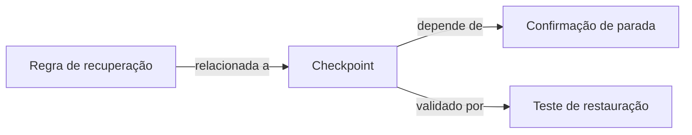

> Leitura: [← Anterior](02-memoria-persistente.md) · [Índice didático](../../02-INDEX.md) · [Próximo →](04-context-packs.md)

# Índices e grafo: como descobrir relações

## Por que uma busca por palavras não basta

Exemplo didático: uma tarefa pede recuperação após limite do provedor. Um documento fala em “cota”; outro explica “encerramento do writer”. As palavras diferem, mas recuperar o trabalho depende de parar quem escreve. A busca textual ajuda a encontrar termos explícitos. O grafo ajuda a percorrer ligações conhecidas.

Um **símbolo** é uma unidade nomeada de código, como função ou classe. Um **import** declara uso de outro módulo. **Análise estática** examina código sem executá-lo. Um **nó** representa um arquivo, símbolo, regra ou contrato. Uma **aresta** representa uma relação entre dois nós. Grafo é o conjunto dessas relações.

Diagrama conceitual proposto; não é resultado de indexação executada.

## Como o índice será construído

O worker recebe revisão e escopo; identifica arquivos; extrai símbolos e imports; registra relações com fontes; publica uma geração completa do índice. **Geração** identifica uma versão consistente do conjunto indexado. Se parte da extração falhar, essa geração não vira completa silenciosamente.

Na atualização seguinte, o **diff** informa o que mudou. Reindexar somente mudanças e seus dependentes reduz trabalho. Um arquivo removido precisa remover suas relações derivadas; um rename precisa registrar o novo caminho sem perder a rastreabilidade.

## O que é análise de impacto

É levantar o que uma alteração pode afetar antes de implementar. A busca encontra componentes iniciais; o grafo expande dependências; contratos e regras explícitas acrescentam vínculos que imports não mostram. A saída é um conjunto de impactos com evidências e lacunas.

A análise não garante descobrir tudo. Eventos, filas, nomes calculados e reflexão podem ocultar ligações. Relações extraídas do código são observações. Uma relação de negócio nova continua sendo proposta até seu aceite.

## Alternativas e limites

Percorrer o repositório inteiro em toda tarefa evita manter índice, mas repete leituras. Um índice incremental economiza trabalho, porém exige invalidação correta. Recomenda-se avaliar extração com ferramentas do ecossistema TypeScript e relações em PostgreSQL; biblioteca e versão não foram escolhidas.

Um banco especializado de grafos não é necessário por definição: as relações podem ser tabelas. A necessidade de tecnologia adicional dependeria de volumes e consultas medidos. Limites de profundidade são configuráveis; atingir um limite precisa produzir uma lacuna explícita, não a afirmação de que não há mais dependências.

Leia o [plano](../../08-desenvolvimento/planos-memoria-e-decisoes/03-indexacao-e-grafo.md).
