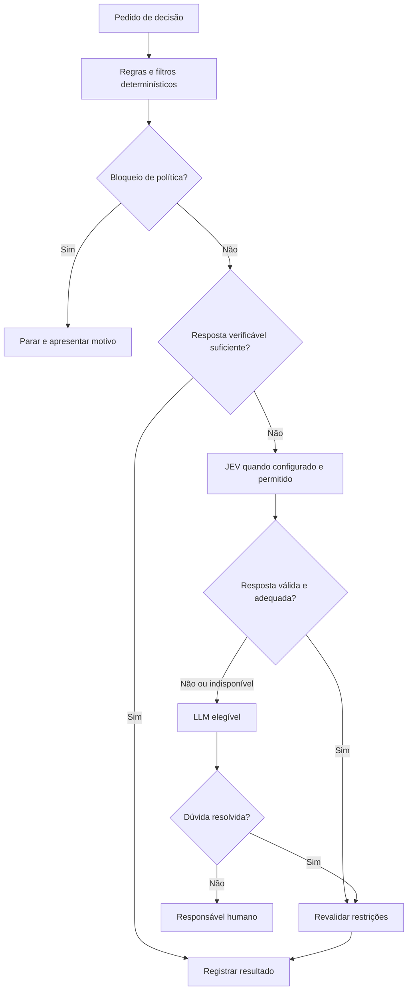

> Leitura: [← Anterior](04-context-packs.md) · [Índice didático](../../02-INDEX.md) · [Próximo →](06-modelo-local.md)

# Decision Engine: quem decide o quê

## Regra determinística não é um modelo treinado

Um mecanismo **determinístico** aplica regras explícitas: com a mesma entrada, versão e configuração, produz o mesmo resultado. Exemplo: se a credencial está ausente, a integração não pode chamar o serviço. Isso não exige IA.

Um **modelo aprendido** estima a partir de padrões. Pode sugerir que um documento é relevante e estar errado. **LLM** é um modelo capaz de trabalhar com linguagem e raciocínio textual, usado em papéis como Tech Lead e Developer. JEV é um modelo especializado em decisões estruturadas. Ter resposta estruturada facilita validação do formato, mas não garante acerto.

## Fluxo proposto

Modelo local poderá ser acrescentado futuramente para recuperação/ranking; não é requisito para chegar ao JEV nesta etapa. Bloqueio de política não é ambiguidade a ser resolvida por um modelo.

## Exemplos para compreender

“Processo anterior parou?” exige evidência do sistema operacional. “Qual dos documentos opcionais explica melhor este ticket?” pode envolver julgamento semântico. “Podemos ignorar esta regra aceita?” exige decisão do responsável e mudança explícita; um score não concede autorização.

**Estratégia** é o método usado para uma decisão. **Política de decisão** define métodos permitidos e limites. **Escalonamento** encaminha uma dúvida para outro método ou para você. O registro deve distinguir sugestão de autorização e de execução.

## Tech Lead e controle manual

O Tech Lead gerencia escolhas de agentes/modelos ao definir tarefas. Você pode alterá-las no controle de tarefas. O executor valida elegibilidade e usa a versão de configuração autorizada. Alteração manual não pode modificar silenciosamente uma tentativa em andamento: a proposta é aplicar na próxima chamada/tentativa compatível, com histórico, sem trocar o writer sem parada.

A semântica exata dessa mudança em execução é proposta técnica a revisar, não requisito inferido. A escolha humana e a escolha do Tech Lead precisam ficar identificadas.

Leia o [plano](../../08-desenvolvimento/planos-memoria-e-decisoes/05-decision-engine.md).
